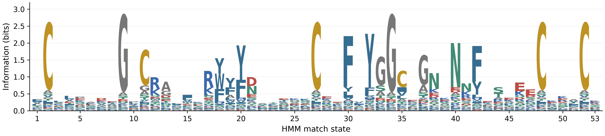

# Kunitz final submission — Elham Hadadi

Submit Final_Report/Elham_Hadadi_Lab1_Visual_Report.pdf as the current report. Word is optional. Read Audit/Submission_Readiness_Audit.md before describing reproducibility. This repository preserves the existing results. The full original backup is stored separately (see below).

## Contents
- Final_Report: current four-page report, six figures and one table.
- Notebooks: executed original snapshot and separate executed retrospective reanalysis.
- Supplementary: selected model/alignment/raw HMMER outputs; recalculated tables; original recalculation; scientific figures and provenance.
- Code: analysis and figure scripts. Some scripts use the documented project-root work/ layout and are supporting sources, not a standalone installed application.
- Audit: fresh execution log and PASS/WARNING checklist.

## Run order / environment
1. Original workflow is historical prerequisite: it made the structural alignment, HMM and archived searches. Inspect the saved outputs in the original notebook. A fresh original Run all uses Google Colab, Drive access, Python/Biopython/pandas/numpy/requests/matplotlib, MUSTANG3.2.4, HMMER3.4 and MMseqs2 15-6f452+ds-2, plus external PDB requests. IMPORTANT: cell55 also requires the separate Nov3 snapshot archive named in the audit; it is missing from this package. Do not replace its hash with that of Nov7.
2. To reproduce reported retrospective results without rebuilding HMM: download the separately linked Nov7 backup and copy it to ~/Downloads locally, or MyDrive/kunitz_project_backups in Colab. Open Notebooks/Lab1_ElhamHadadi_Reanalysis_Executed.ipynb in Python3/Jupyter or Colab; use an empty working directory and Run all. Colab may request Drive mounting. It checks/extracts archived inputs and computes original benchmark, expanded validation threshold, expanded test and full-scan summaries. No HMMER execution or retraining occurs.
3. Expected threshold17.2; test TP172/FN2/FP2/TN283816; full scan398 predictions. Original8.7 comparison remains historical. Reanalysis uses Python standard library; the notebook is self-contained.
4. Figure code expects work/raw_audit (extracted backup), work/reanalysis (computed outputs), and matplotlib/numpy. To run locally, install those packages normally; task-specific work/report_packages is only an optional search path. Supplementary includes rendered figures and their source data so new rendering is not necessary to check counts.

Reanalysis is retrospective. No direct seed overlap does not imply no homologous relatives. The entire supplementary archive may exceed portal limits; use its report-only PDF and provide supplementary files by the course-approved method. No upload or submission was performed.

## Read the report
[Final report (PDF)](Final_Report/Elham_Hadadi_Lab1_Visual_Report.pdf) · [Editable report](Final_Report/Elham_Hadadi_Lab1_Visual_Report.docx)

## Large source archive
The full Nov7 backup (616,589,569 bytes) is not committed to Git. The owner retains it in Google Drive:
[Original backup download](https://drive.google.com/file/d/1WBFyxo18TtFOom_M_cH_BvdCJNNUbiA9/view).
Access depends on existing Drive permissions; anonymous access has not been verified and no sharing settings were changed.
The original older Nov3 snapshot required by the original notebook is still a separately documented missing dependency.
Large reanalysis CSV and raw HMMER tables are stored with gzip compression (`.gz`); decompress with Python gzip or `gunzip` before using scripts that expect `.csv`. Their contents are unchanged.

## Results at the fixed 17.2-bit threshold
Test: TP=172, FN=2, FP=2, TN=283,816; sensitivity/precision=98.85%, MCC=0.9885.
Full Swiss-Prot scan: 398 predicted proteins, 485 above-threshold domains.
These are retrospective archived-score results. Exact-overlap checks do not exclude residual homology. Model and threshold were not changed for this GitHub publication.

## Figures

