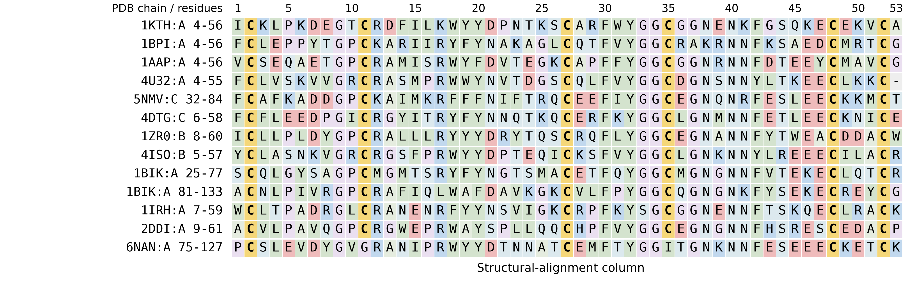
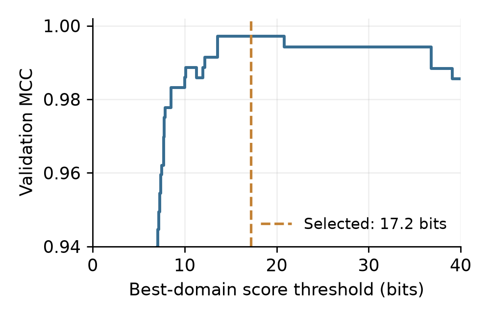
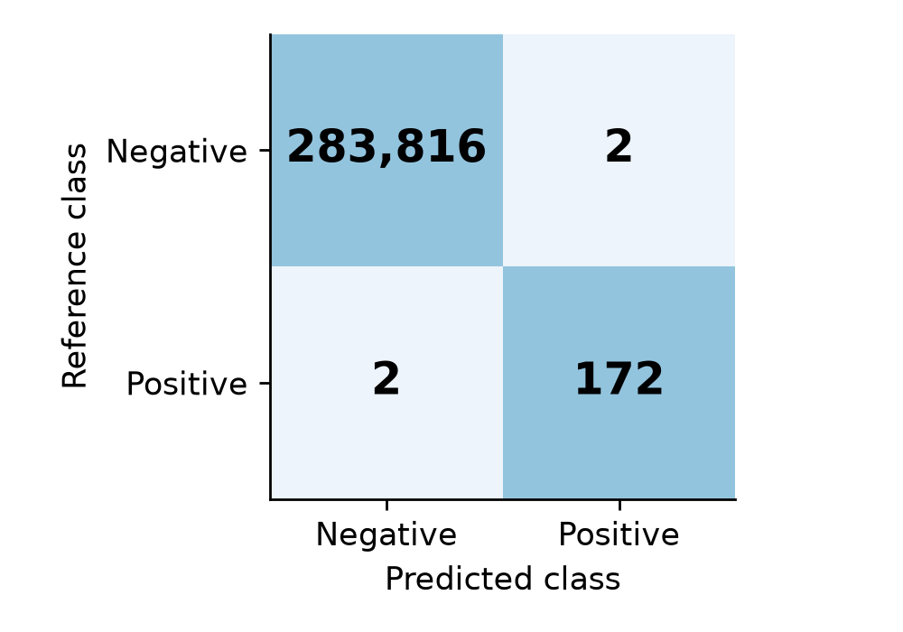
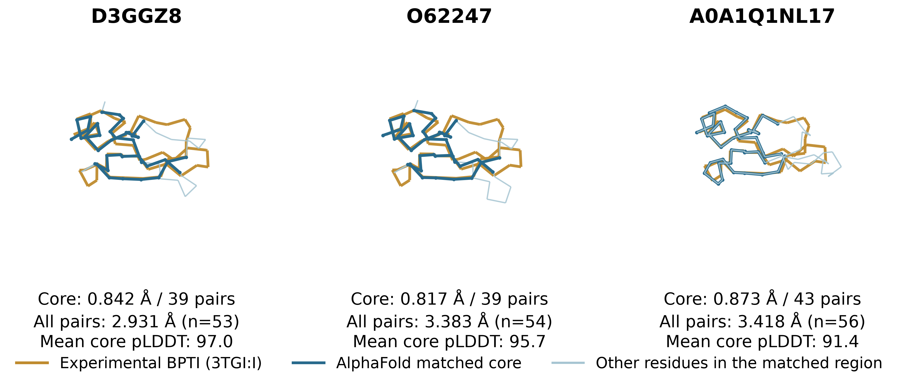
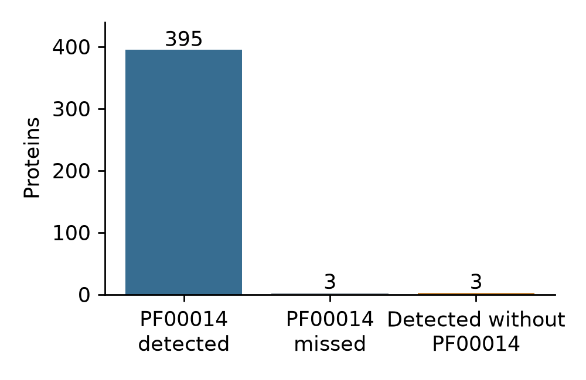
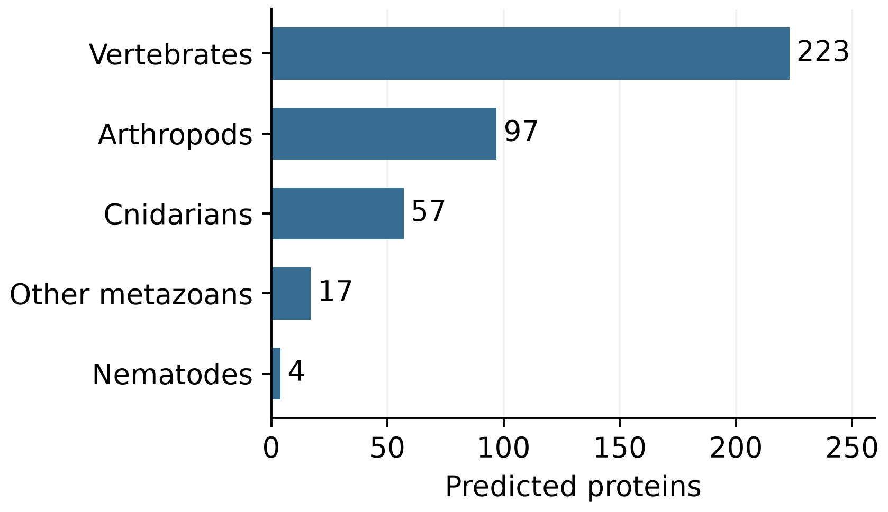

# Detecting Kunitz domains with a profile HMM

**Elham Hadadi**  
Laboratory of Bioinformatics I · University of Bologna

This report describes the complete project: structural data selection, seed alignment, profile-HMM construction, evaluation, retrospective threshold calibration, error analysis and application to Swiss-Prot. It distinguishes the original analysis from the subsequent reanalysis of the saved search results.

[Five-page report (PDF)](Final_Report/Elham_Hadadi_Lab1_Visual_Report.pdf) · [Editable report](Final_Report/Elham_Hadadi_Lab1_Visual_Report.docx) · [Original executed notebook](Notebooks/Lab1.ElhamHadadi.snapshot-fixed.ipynb) · [Executed reanalysis notebook](Notebooks/Lab1_ElhamHadadi_Reanalysis_Executed.ipynb)

## Contents

1. [Abstract](#1-abstract)
2. [Scientific question](#2-scientific-question)
3. [Structural dataset and seed selection](#3-structural-dataset-and-seed-selection)
4. [Alignment and HMM construction](#4-alignment-and-hmm-construction)
5. [Evaluation datasets and separation](#5-evaluation-datasets-and-separation)
6. [Scoring and threshold selection](#6-scoring-and-threshold-selection)
7. [Validation and test results](#7-validation-and-test-results)
8. [Error analysis](#8-error-analysis)
9. [Complete Swiss-Prot search](#9-complete-swiss-prot-search)
10. [Discussion and limitations](#10-discussion-and-limitations)
11. [Reproducibility and repository files](#11-reproducibility-and-repository-files)
12. [Conclusion](#12-conclusion)
13. [References](#13-references)

## 1. Abstract

**Motivation.** This project investigates whether a profile hidden Markov model built from structurally aligned Kunitz fragments can identify related domains in Swiss-Prot.

**Methods.** Thirteen structural fragments were aligned with MUSTANG and used to build a 53-state HMM. Reviewed, nonfragment Swiss-Prot proteins were evaluated using PF00014 annotation as the reference. A retrospective reanalysis expanded the negative evaluation background while retaining the model and original positive split.

**Results.** Validation MCC selected a 17.2-bit threshold. The corresponding test produced 172 true positives, two false negatives, two false positives and 283,816 true negatives: sensitivity and precision were 98.85%, and MCC was 0.9885. Complete Swiss-Prot screening identified 398 proteins containing 485 above-threshold domains.

**Availability.** The report, executed notebooks, model, alignment, selected search outputs and result tables are provided in this repository; the full source backup is linked separately.

## 2. Scientific question

The aim was to use structural information to construct a sequence model for Kunitz-domain detection. Bovine pancreatic trypsin inhibitor (BPTI) served as the introductory example. The project followed the path from identifying the relevant chain and domain in a structure to recognizing related sequence patterns in a protein database.

A profile HMM describes position-specific amino-acid preferences together with insertions and deletions. Here, a structural alignment supplied the seed correspondence between positions, and HMMER converted this alignment into a searchable sequence model [1,2].

The analysis addressed three practical questions:

- Can the model recognize its own seed fragments as a construction consistency check?
- How well does it classify proteins relative to the specified Swiss-Prot annotation reference?
- What additional candidates and taxonomic patterns appear in a complete-database search?

Detection of a Kunitz-related sequence does not establish protease-inhibitory activity. Functional conclusions require evidence beyond a profile match.

## 3. Structural dataset and seed selection

### 3.1 Finding the relevant structural fragments

Structural candidates were retrieved from PDB polymer entities annotated with PF00014. The search returned **165 entities from 162 PDB entries**. Annotated domain intervals were checked against the available coordinates so that the selected fragment represented the domain rather than an entire protein chain.

Chain identity was important in the introductory structure **3TGI**: author chain **I** contains BPTI, while chain **E** contains trypsin. This distinction avoided treating the interacting enzyme as the inhibitor domain.

### 3.2 Quality and redundancy checks

Candidate selection considered coordinate completeness, experimental method, resolution, mutation annotations and sequence redundancy. The initial length review band was **45–65 residues**, and X-ray candidates required a resolution of **2.5 Å or better**. NMR structures were inspected across their models, with model 1 used for final fragment extraction.

Sequence redundancy was reduced at **90% identity**, followed by manual review of the remaining candidates. These were project-specific selection criteria, rather than universal definitions of a Kunitz domain.

| Final seed property | Value |
| :--- | ---: |
| Structural fragments | 13 |
| Distinct UniProt accessions | 10 |
| X-ray fragments | 10 |
| NMR fragments | 3 |
| Fragments of 53 residues | 12 |
| Fragments of 52 residues | 1 |

The final seed therefore represents 13 fragments, not 13 independent protein accessions. The [fragment manifest](Supplementary/selected_inputs/data/processed/PF00014_fragment_manifest.csv) records the selected intervals and their provenance.

## 4. Alignment and HMM construction

### 4.1 Structural alignment

The fragments were aligned using **MUSTANG** [1]. The resulting sequence alignment derived from structural superposition contained **53 columns and one gap**. Removing alignment gaps recovered every input seed sequence, confirming consistency between the extracted fragments and the alignment.



**Figure 1.** Sequence alignment derived from the MUSTANG structural superposition. Labels identify the PDB entry, label chain and selected interval. Cysteines are highlighted in yellow. Columns **2, 27, 48 and 52** contain cysteine in every fragment; the figure does not imply that six cysteines are invariant across this seed.

### 4.2 Profile construction and training consistency

The alignment was converted to **Stockholm format** and supplied to HMMER `hmmbuild`. The resulting model contained **53 match states**. All 13 training fragments were subsequently retrieved by `hmmsearch`.

This is a **training consistency check**: it shows that the model can recognize the sequences used to construct it. It is separate from evaluation on proteins excluded from training.


**Figure 2.** Logo calculated from the saved HMM match-state emission probabilities. Stack height represents information relative to a uniform amino-acid background, with individual letters weighted by their emission probabilities. Positions refer to model states, not residue numbers in full-length proteins. The logo was extracted from the existing model without retraining.

The saved [HMM and Stockholm alignment](Supplementary/selected_inputs/results/hmm/build_20261107T212501_925161Z/) are accompanied by a build record containing their hashes.

### 4.3 Quantitative review of structural alignment quality

The existing MUSTANG alignment was reviewed using its **52 gap-free columns**. Independent Cα least-squares fits were calculated for **all 78 unordered pairs** of the 13 fragments. They reproduced the archived pairwise RMSDs to numerical precision.

| Structural quality measure | Result |
| :--- | ---: |
| Mean pairwise fitted Cα RMSD | 0.920 Å |
| Pairwise RMSD range | 0.431–1.879 Å |
| Mean pairwise Q score | 0.877 |
| Largest per-fragment mean RMSD | 1.603 Å (6NAN) |

Q was calculated from the fixed MUSTANG correspondence using the [PDBeFold definition](https://www.ebi.ac.uk/msd-srv/ssm/rl_qscore.html):

```text
Q = Nalign² / [(1 + (RMSD / 3 Å)²) × N1 × N2]
```

N1 and N2 are the full selected-fragment lengths. Each plotted point averages one fragment's 12 pairwise comparisons. This is a review of the original alignment, rather than a new PDBeFold/SSM alignment. All 13 fragments were retained and the HMM was unchanged.


## 5. Evaluation datasets and separation

### 5.1 Annotation reference and eligibility

Evaluation used reviewed, nonfragment proteins from the archived **Swiss-Prot 2026_03** release:

- **Reference positive:** PF00014 annotation present.
- **Reference negative:** PF00014 annotation absent.

This is an operational annotation-based reference. A missing PF00014 annotation is not experimental proof that a Kunitz domain is absent. The labels were retained during error review, including cases with other Kunitz evidence.

There were initially **368 nonfragment positive candidates**. Training-accession overlap and exact training-fragment matches excluded 15 proteins. Another five met a local similarity criterion of at least **90% identity and 90% seed coverage**. This left **348 eligible positives**.

### 5.2 Original sampled-negative benchmark

The original analysis sampled **3,480 negatives** from a pool of **566,072 eligible reference negatives**, using seed 42. Each evaluation subset contained 174 positives and 1,740 negatives.

Original similarity groups used MMseqs2 matches at **at least 80% identity over 40 paired standard residues**, with exact duplicates kept together [3]. Validation and test did not share the retained groups.

### 5.3 Retrospective expansion of the negative background

The reanalysis retained the original positive allocation and included the complete nonfragment negative pool. It preserved the accepted original groups and allocations, while globally grouping exact complete-sequence duplicates. New negative groups were assigned deterministically using seed 42 and the smallest accession in each group.

| Dataset | Positives | Negatives | Total |
| :--- | ---: | ---: | ---: |
| Original validation | 174 | 1,740 | 1,914 |
| Original test | 174 | 1,740 | 1,914 |
| Expanded validation | 174 | 282,254 | 282,428 |
| Expanded test | 174 | 283,818 | 283,992 |

No conflicting-label exact-sequence groups were found. The expanded evaluation contained **566,420 proteins** overall.

### 5.4 What the separation checks establish

A direct-overlap audit across all 566,420 evaluation proteins found:

- No training accession in the evaluation membership.
- No exact occurrence of a complete seed fragment within an evaluation sequence.
- No shared validation/test accession, exact complete-sequence hash or retained group.

These checks exclude the stated forms of direct duplication. They do **not** exclude shorter shared segments or evolutionary relationships. Added negatives were not exhaustively reclustered for homology. The detailed results are available in the [overlap audit](Supplementary/Kunitz_Direct_Training_Overlap_Audit.json).

## 6. Scoring and threshold selection

### 6.1 Decision rule

Protein classification used the **best single-domain bit score**, taken from column 9 of HMMER `tblout` output (Python index 8). It did not use the full-sequence score.

```text
Predicted positive: a reported best-domain score >= the selected threshold
Predicted negative: score below threshold, or no reported hit
```

Domain counts were computed separately using column 14 of `domtblout` (Python index 13), applying the same cutoff to each reported domain.

The archived searches used:

```text
--max --noali -E 1000000 --domE 1000000 --seed 42 --cpu 2
```

These permissive reporting settings were separate from the classification rule. UniProt identifiers were normalized to accessions, and scores were interpreted at the one-decimal precision recorded in the output tables.

### 6.2 Selecting the cutoff

The initial sampled-negative validation selected **8.7 bits**, the midpoint of its optimal interval **(6.1, 11.3]**. The original test had no classification errors at this cutoff.

The expanded-negative reanalysis selected the midpoint of the widest interval maximizing **validation MCC**. Its optimal interval was **(13.6, 20.8]**, giving **17.2 bits**. This value was recorded before being applied to the reanalysis test set.

The model, seed alignment and raw HMMER searches were unchanged. The reanalysis changed the evaluation background and recalibrated the threshold from saved scores. Because the original results had already been inspected, this remains a **retrospective reanalysis**, rather than a fresh external test.



**Figure 3.** Validation MCC as a function of the score cutoff. The dashed line marks the selected 17.2-bit midpoint. Test metrics were not the criterion used to select this cutoff.

### 6.3 Evaluation measures

Sensitivity measures the fraction of reference positives recovered; precision measures the fraction of positive predictions carrying the reference label. Specificity measures the fraction of reference negatives rejected.

```text
Sensitivity = TP / (TP + FN)
Precision   = TP / (TP + FP)
Specificity = TN / (TN + FP)
F1          = 2TP / (2TP + FP + FN)
MCC         = (TP × TN − FP × FN)
              / sqrt[(TP + FP)(TP + FN)(TN + FP)(TN + FN)]
```

MCC was the recorded threshold-selection criterion. The separate sensitivity and precision values show the practical consequences of that choice.

## 7. Validation and test results

### 7.1 Expanded evaluation at 17.2 bits

| Outcome or measure | Validation | Test |
| :--- | ---: | ---: |
| True positives | 173 | 172 |
| False negatives | 1 | 2 |
| False positives | 0 | 2 |
| True negatives | 282,254 | 283,816 |
| Sensitivity | 99.43% | 98.85% |
| Precision | 100.00% | 98.85% |
| Specificity | 100.00% | 99.9993% |
| F1 score | 0.9971 | 0.9885 |
| MCC | 0.9971 | 0.9885 |

The test sensitivity is **172/174**, and precision is also **172/174**. The equal values arise because this test has two false negatives and two false positives.



**Figure 4.** Test confusion matrix at the fixed 17.2-bit cutoff. The two reference-positive misses and two reference-negative matches are examined below.

### 7.2 Comparing both cutoffs on the same expanded test

| Cutoff | TP | FN | FP | TN | Sensitivity | Precision | MCC |
| :--- | ---: | ---: | ---: | ---: | ---: | ---: | ---: |
| 8.7 bits | 174 | 0 | 9 | 283,809 | 100.00% | 95.08% | 0.9751 |
| 17.2 bits | 172 | 2 | 2 | 283,816 | 98.85% | 98.85% | 0.9885 |

The original perfect sampled benchmark was numerically correct. Its random negative sample did not include the rare reference-negative matches found in the larger background.

On the expanded test, the higher cutoff reduces false positives from nine to two but loses two reference positives. It improves precision and MCC while reducing sensitivity. It is therefore a different operating point, not a uniformly better detector for every biological objective. The test comparison illustrates the trade-off; validation MCC determined the selected cutoff.

### 7.3 Comparison with the official Pfam reference

The official **PF00014.31** HMM was downloaded from InterPro release 111.0 on 18 November 2026. It contains 53 match states and 98 seed sequences. Both this reference and the unchanged structural HMM were searched afresh against the same 566,420 evaluation proteins, using PyHMMER 0.12.3 with the permissive settings described above. All 283,992 structural-model test classifications exactly matched the archived benchmark.

The primary reference cutoff was selected solely by validation MCC, using the same midpoint rule as the structural analysis. The optimal interval was (19.6, 21.0] bits, giving **20.3 bits**. The original structural cutoff remained **17.2 bits**. The published Pfam gathering cutoffs (GA) were also evaluated without tuning: both sequence and domain scores must be at least 21 bits.

| Model and operating point | Test TP | FN | FP | TN | Sensitivity | Precision | MCC |
| :--- | ---: | ---: | ---: | ---: | ---: | ---: | ---: |
| Structural HMM, fixed 17.2 bits | 172 | 2 | 2 | 283816 | 98.85% | 98.85% | 0.9885 |
| Pfam, validation-selected 20.3 bits | 174 | 0 | 1 | 283817 | 100.00% | 99.43% | 0.9971 |
| Pfam, published 21-bit GA | 174 | 0 | 0 | 283818 | 100.00% | 100.00% | 1.0000 |

Calibrated Pfam recovered both structural-model false negatives, **A0A1Q1NL17** and **O62247**, and rejected **Q09JW3**. **P56409** remained an annotation-defined false positive at 20.3 bits but was rejected at the published GA cutoff.

The published GA rule produced 173 TP and 1 FN on validation. The missed protein **Q8WPG5** has native sequence/domain score 20.956762 bits: its rounded tblout value is 21.0, so using rounded scores for the GA boundary would incorrectly include it. The native-score boundary check is archived in the supplement. The primary midpoint comparison consistently uses the one-decimal precision specified by its protocol.

Pfam performed better on this annotation-defined benchmark. Since PF00014 annotation defines the labels, the comparison measures agreement with that reference and is not independent biological validation. Possible overlap between the reference seed and evaluation proteins was not excluded. The result does not demonstrate that the models are equivalent or that using fewer training sequences is inherently superior.

[Comparison methods and provenance](Supplementary/pfam_comparison/README.md) · [Executed calculation notebook](Supplementary/pfam_comparison/Pfam_Comparison_Executed.ipynb) · [Full result summaries](Supplementary/pfam_comparison/computed/comparison_results.json) · [Test disagreements](Supplementary/pfam_comparison/computed/test_disagreements.csv)

## 8. Error analysis

### 8.1 Missed reference positives

| Accession | Best-domain score | Evaluation subset | Classification at 17.2 bits |
| :--- | ---: | :--- | :--- |
| A0A1Q1NL17 | 11.2 | Test | False negative |
| D3GGZ8 | 11.3 | Validation | False negative |
| O62247 | 13.9 | Test | False negative |

All three scores are below 17.2 bits and above 8.7 bits. Their classification is consistent with the stated threshold rule. These cases demonstrate the loss in recovery associated with the more conservative cutoff; their scores alone do not establish the biological reason for the weaker matches.

### 8.2 Reference-negative test matches

| Accession | Protein | Best-domain score | Archived evidence |
| :--- | :--- | ---: | :--- |
| P56409 | Ornithodorin | 18.0 | Other BPTI/Kunitz domain evidence |
| Q09JW3 | Monogrin 2 | 17.2 | Other BPTI/Kunitz domain evidence |

Both lack the PF00014 reference label but have other archived Kunitz evidence. They remain **false positives relative to the fixed annotation definition**. This does not establish that they are biologically incorrect domain matches, and the labels were not changed after inspecting the predictions.

Q09JW3 lies exactly at the reported cutoff. Both its stored score and the threshold parse as 17.2, and the inclusive `>=` rule predicts it positive. Unreported internal HMMER score digits were not assessed.

The third additional candidate in the complete-database application, **P84555**, was explicitly annotated as a Kunitz fragment. Fragment status excluded it from evaluation but did not exclude it from the full-database scan. These annotation reviews provide existing support, rather than new experimental confirmation.

### 8.3 Three-dimensional review of the missed reference positives

AlphaFold DB models for **D3GGZ8, O62247 and A0A1Q1NL17** were retrieved as model files of version 6. Their full sequences matched the archived project sequences exactly. D3GGZ8 was the validation false negative; the other two were test false negatives.

Each predicted chain was superimposed onto experimentally observed BPTI from **3TGI, author chain I**, using **ChimeraX 1.11.1 Matchmaker**. The settings were recorded explicitly, including BLOSUM-62, sequence/secondary-structure alignment and iterative **2 Å pruning**.

| Protein | Subset | Core Cα pairs | Core RMSD | All aligned pairs | All-pair RMSD | Mean core pLDDT |
| :--- | :--- | ---: | ---: | ---: | ---: | ---: |
| D3GGZ8 | Validation | 39 | 0.842 Å | 53 | 2.931 Å | 97.0 |
| O62247 | Test | 39 | 0.817 Å | 54 | 3.383 Å | 95.7 |
| A0A1Q1NL17 | Test | 43 | 0.873 Å | 56 | 3.418 Å | 91.4 |



The images display Cα traces of the matched regions. Gold is experimental BPTI; dark blue marks the retained predicted core, and pale blue the other residues in that target region. All-pair RMSD is calculated over every sequence-aligned pair under the final core transform; it is not a full-protein RMSD.

The small core deviations and high mean core prediction confidence support local fold similarity in the missed sequences. The larger all-pair deviations show why the core fit should not be generalized to the complete protein. This is predicted structural evidence, not experimental confirmation or proof of the unique cause of each low HMM score. The full and core RMSDs were independently checked from the transformed coordinates.

[Structural methods and inputs](Supplementary/structural_analysis/README.md) · [Executed calculation notebook](Supplementary/structural_analysis/Structural_Analysis_Executed.ipynb) · [Native ChimeraX log](Supplementary/structural_analysis/results/chimerax_execution.log) · [Results table](Supplementary/structural_analysis/results/false_negative_structure_summary.csv)

## 9. Complete Swiss-Prot search

### 9.1 Protein and domain counts

The fixed model was applied to the archived search of all **575,748 Swiss-Prot proteins**. At 17.2 bits:

| Complete-database result | Count |
| :--- | ---: |
| Predicted positive proteins | 398 |
| Domains above threshold | 485 |
| Proteins with multiple above-threshold domains | 52 |
| PF00014-annotated proteins detected | 395 |
| PF00014-annotated proteins missed | 3 |
| Predictions without PF00014 | 3 |
| Explicitly flagged fragments among predictions | 31 |

The full PF00014 reference contained **398 proteins: 368 nonfragments and 30 fragments**. All 30 annotated fragments were among the predictions. Together with P84555, they account for the 31 predicted fragments.

The number of predicted proteins happens to equal the number of reference proteins, but the memberships differ: **three annotated proteins were missed and three additional proteins were predicted**.



**Figure 5.** Complete-database annotation comparison: 395 reference proteins detected, three missed and three additional predictions. Annotation agreement among predictions is **395/398 = 99.25%**; it is not a definitive estimate of biological precision.

This scan includes training and evaluation proteins. It describes database application of the model, not a separate independent performance test.

### 9.2 Taxonomic distribution

| Taxonomic bin | Predicted proteins |
| :--- | ---: |
| Vertebrates | 223 |
| Arthropods | 97 |
| Cnidarians | 57 |
| Other metazoans | 17 |
| Nematodes | 4 |
| **Total** | **398** |



**Figure 6.** Taxonomic bins of predicted proteins. These are raw counts, without normalization by database size in each group; the bins are descriptive and do not represent equivalent taxonomic ranks.

All predictions fell within metazoan bins at this cutoff. Weaker fungal and bacterial predictions present in the initial 8.7-bit scan did not remain at 17.2 bits. The distribution depends on the seed, score cutoff, database composition and annotation coverage; it is not an estimate of natural prevalence.

## 10. Discussion and limitations

### Background sampling affects calibration

The expanded analysis exposed reference-negative matches absent from the original random sample. The change from an error-free small benchmark to imperfect expanded evaluation does not mean the initial arithmetic was wrong. It shows that the negative background influences threshold calibration and measured precision.

The recalibrated threshold was selected by the recorded validation criterion. Its justification is the validation result and the resulting sensitivity–precision trade-off, rather than a preference for avoiding a 100% result.

### Annotation agreement differs from biological correctness

Using PF00014 for structural candidate identification and evaluation provides a consistent family reference, but does not make that reference experimentally complete. The two test false positives illustrate this limitation. Likewise, detecting the seed fragments checks model construction but cannot independently validate biological generalization.

### Direct duplication and homology are different issues

The absence of training accessions and complete seed-fragment matches supports direct separation. It does not establish independence between homologous proteins. Only **nine test positives** had less than 40% identity to their closest coverage-qualified seed match. The model detected **seven of these nine** at 17.2 bits, compared with all nine at 8.7 bits.

This small subset illustrates a recovery trade-off, but does not establish broad remote-homology performance. The 80% grouping rule does not remove all evolutionary relationships, and the new negatives were grouped for exact duplication rather than exhaustively for homology.

### Seed size and retrospective design

The model uses 13 fragments from 10 accessions. Selection emphasizes structural quality and reduced redundancy, but the seed cannot be assumed to represent the entire diversity of the family. The reanalysis also retains the original positive split after earlier results had been inspected.

A future assessment could use a new external dataset and stricter homology-aware separation. The reference-model comparison in Section 7.3 adds an established baseline, but does not resolve these independence limitations.

## 11. Reproducibility and repository files

### 11.1 Software and saved execution

The original analysis used Google Colab, Python/Biopython, MUSTANG **3.2.4**, HMMER **3.4** and MMseqs2 **15-6f452+ds-2**. The saved original notebook contains 70 executed code cells without recorded error outputs. The separate reanalysis notebook contains six executed code cells.

During the final local audit, the reanalysis calculation cells were executed again from archived data, reproducing the selected threshold and result summaries. All **2,270 files** listed in the complete source-backup manifest were checked against their recorded sizes and SHA256 hashes. The verification scope and execution log are in [Audit](Audit/).

The earlier audit did not rebuild the HMM or rerun its searches. The subsequent Pfam comparison searched both fixed models afresh and reproduced all structural-model test decisions. A complete fresh run of the original structure-retrieval and model-building workflow remains a separate claim.

### 11.2 Repository structure

| Location | Purpose |
| :--- | :--- |
| [Final_Report](Final_Report/) | Five-page PDF and editable Word report |
| [Notebooks](Notebooks/) | Executed original workflow and retrospective reanalysis |
| [Code](Code/) | Score recalculation, full-scan summaries, overlap checks and figure-generation sources |
| [Supplementary/selected_inputs](Supplementary/selected_inputs/) | Structural seed, fragment manifest, Stockholm alignment, HMM, build record and selected HMMER outputs |
| [Supplementary/reanalysis](Supplementary/reanalysis/) | Protocol, split assignments, threshold sweep, predictions, errors and result summaries |
| [Supplementary/raw_recomputed](Supplementary/raw_recomputed/) | Recalculation of the original benchmark |
| [Supplementary/model_evidence_figures](Supplementary/model_evidence_figures/) | Alignment figure, model logo, taxonomy figure, emission table and provenance |
| [Supplementary/final_reanalysis_figures](Supplementary/final_reanalysis_figures/) | Confusion matrix, validation curve and full-scan comparison |
| [Supplementary/structural_analysis](Supplementary/structural_analysis/) | Seed quality, predicted-structure superpositions, coordinates and executed checks |
| [Supplementary/pfam_comparison](Supplementary/pfam_comparison/) | Official reference HMM, matched search outputs, comparison notebook and provenance |
| [Audit](Audit/) | Submission-readiness checklist and calculation log |
| [SHA256SUMS.json](SHA256SUMS.json) | Checksums of repository project files |

### 11.3 Running the archived-score reanalysis

1. Download the [full November 7 source backup](https://drive.google.com/file/d/1WBFyxo18TtFOom_M_cH_BvdCJNNUbiA9/view), named `kunitz_project_backup_20261107T213430_789701Z.zip`.
2. Place it in `~/Downloads` for local execution, or `MyDrive/kunitz_project_backups` for Google Colab. Existing Drive permissions apply.
3. Open the [reanalysis notebook](Notebooks/Lab1_ElhamHadadi_Reanalysis_Executed.ipynb) with Python 3 in a fresh working directory and run the cells in order.
4. The notebook verifies and extracts its archived inputs, reconstructs the original benchmark, assigns the expanded background and computes validation, test and full-scan results.
5. Confirm the expected 17.2-bit cutoff, test counts **172/2/2/283,816** (TP/FN/FP/TN) and **398** full-scan predictions.

The notebook calculates results using the Python standard library. Figure generation additionally uses NumPy and Matplotlib. Supporting scripts expect the `work/raw_audit` and `work/reanalysis` directory layout used by the notebooks. Large CSV and raw HMMER tables in this repository are gzip-compressed; decompress them before passing them to scripts expecting uncompressed filenames.

### 11.4 Remaining execution dependency

The full backup is linked separately because of its size. A fresh execution of the **original** snapshot-fixed notebook additionally requires `kunitz_project_backup_20261103T233052_775093Z.zip`, an older snapshot requested by that notebook. This older archive is not included in the repository; its Drive accessibility has not been verified. External service access and software installation would also need to be available for a complete new original run.

This dependency does not prevent the archived-score reanalysis from reproducing the reported results. It does prevent describing the original notebook as a verified, self-contained fresh “Run all.” See the [complete checklist](Audit/Submission_Readiness_Audit.md) for details.

## 12. Conclusion

A structural seed of 13 Kunitz fragments produced a 53-state profile HMM. Expanding the negative evaluation background changed the validation-selected cutoff from 8.7 to 17.2 bits while preserving the model and raw searches. The resulting test sensitivity and precision were **98.85%**, with **MCC 0.9885**.

Applied to complete Swiss-Prot, the fixed rule identified **398 candidate proteins**, including 395 PF00014-annotated proteins and three additional candidates with archived Kunitz evidence. The results support candidate detection within the defined evaluation setting, with explicit limits from annotation completeness, residual homology, seed diversity and retrospective calibration.

## 13. References

1. Konagurthu AS, Whisstock JC, Stuckey PJ, Lesk AM. MUSTANG: a multiple structural alignment algorithm. *Proteins*. 2006;64:559–574. [doi:10.1002/prot.20921](https://doi.org/10.1002/prot.20921).
2. Eddy SR. Accelerated Profile HMM Searches. *PLoS Computational Biology*. 2011;7:e1002195. [doi:10.1371/journal.pcbi.1002195](https://doi.org/10.1371/journal.pcbi.1002195).
3. Steinegger M, Söding J. MMseqs2 enables sensitive protein sequence searching for the analysis of massive data sets. *Nature Biotechnology*. 2017;35:1026–1028. [doi:10.1038/nbt.3988](https://doi.org/10.1038/nbt.3988).
4. Hadadi E. Laboratory of Bioinformatics I Kunitz project. [Original executed notebook](Notebooks/Lab1.ElhamHadadi.snapshot-fixed.ipynb) and [retrospective reanalysis](Notebooks/Lab1_ElhamHadadi_Reanalysis_Executed.ipynb), with archived inputs and outputs linked above.

5. InterPro. Pfam PF00014.31 Kunitz/BPTI profile HMM, InterPro 111.0. [Official profile source](https://www.ebi.ac.uk/interpro/wwwapi/entry/pfam/PF00014/?annotation=hmm).

6. EMBL-EBI. [PDBeFold Q-score definition](https://www.ebi.ac.uk/msd-srv/ssm/rl_qscore.html).
7. UCSF RBVI. [ChimeraX Matchmaker documentation](https://www.cgl.ucsf.edu/chimerax/docs/user/commands/matchmaker.html).
8. AlphaFold Protein Structure Database. [Model metadata and API](https://alphafold.ebi.ac.uk/api-docs); individual model records are archived in the structural supplement.
