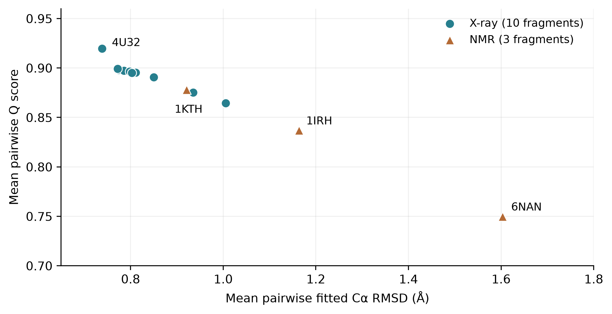
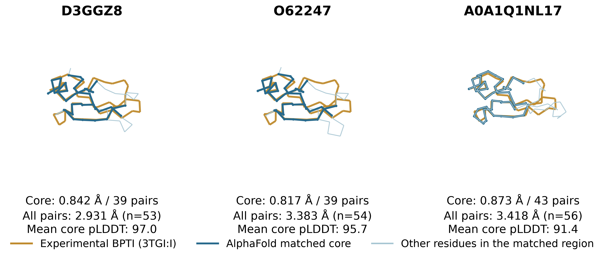

# Structural quality and false-negative review

**Elham Hadadi · Laboratory of Bioinformatics I**

This supplement reviews the existing training alignment and examines predicted structures for the project's three missed reference positives. The training membership, HMM, 17.2-bit cutoff, reference labels and classification results are unchanged.

## Training alignment quality

The 13 original fragments were compared using the 52 gap-free columns of the 53-column MUSTANG alignment. Independent Cα least-squares fits for all 78 unordered pairs reproduced the archived RMSDs to numerical precision. The mean was **0.920 Å**, with a range of **0.431–1.879 Å**.

The published PDBeFold Q-score definition was applied to these fixed correspondences:

```text
Q = Nalign² / [(1 + (RMSD / 3 Å)²) × N1 × N2]
```

N1 and N2 are the selected fragment lengths, 52 or 53 residues. Mean pairwise Q was **0.877**. Each plotted point averages one fragment's 12 comparisons. 6NAN had the largest mean RMSD, **1.603 Å**. No fragment was removed following this review.

These are diagnostics calculated from the existing MUSTANG correspondence, rather than a new PDBeFold/SSM alignment. They should not be equated with another program's consensus-alignment scores.



## Structural review of missed positives

AlphaFold DB model files, **file version 6**, were retrieved on 18 November 2026. Each full model sequence was checked against the archived project sequence and matched exactly. D3GGZ8 is the validation false negative; O62247 and A0A1Q1NL17 are test false negatives.

ChimeraX **1.11.1 Matchmaker** aligned each model's chain A to the experimentally observed BPTI chain I from 3TGI. Explicit settings were BLOSUM-62, Needleman–Wunsch alignment, secondary-structure weight 0.3, gap extension 1, helix/strand/other gap opening 18/18/6, computed secondary structure and iterative 2 Å pruning. The complete commands and native log are included.

| Protein | Subset | Core pairs | Core RMSD (Å) | All pairs | All-pair RMSD (Å) | Mean core pLDDT |
| :--- | :--- | ---: | ---: | ---: | ---: | ---: |
| D3GGZ8 | validation | 39 | 0.842 | 53 | 2.931 | 97.0 |
| O62247 | test | 39 | 0.817 | 54 | 3.383 | 95.7 |
| A0A1Q1NL17 | test | 43 | 0.873 | 56 | 3.418 | 91.4 |

“All-pair RMSD” includes all sequence-aligned Cα pairs under the final pruned-core transform. It is not a full-protein RMSD or an independently optimized unpruned RMSD. Core RMSD uses only the retained matched pairs. Both measures were independently recomputed from the transformed coordinates, and core pLDDT was verified from the corresponding Cα confidence fields.



The figures show actual Cα traces, with unmatched parts of the complete proteins omitted. Gold represents experimental BPTI, dark blue the matched predicted core, and pale blue other residues in the matched target region. The small core RMSDs and high reported core confidence support local fold similarity. They do not establish experimental structure, whole-protein equivalence, inhibitory activity or the unique cause of a lower HMM score.

## Reproduce the calculations

1. Install the packages in `requirements.txt`. Open `Structural_Analysis_Executed.ipynb` with this folder as its working directory, or run `compute_quality.py` and `verify_structures.py`. Both notebook calculations were executed successfully with the included inputs.
2. To repeat native superposition, run `ChimeraX --nogui --exit --script /absolute/path/run_chimerax.py` using ChimeraX 1.11.1. It opens the supplied coordinates in a separate headless session and writes results under `results/`.
3. Run `make_figures.py` to regenerate the scientific plots from those coordinates.

## Files

- `inputs/`: original seed fragments, alignment, BPTI reference, archived RMSDs, AlphaFold structures and metadata, and the original case sequences and labels.
- `results/`: all 78 pairwise comparisons, per-fragment summaries, native Matchmaker results, residue mappings, confidence values, independent checks and the execution log.
- `results/*_aligned_target.pdb`: transformed target coordinates, suitable for opening together with `inputs/3TGI_chain_I.pdb`.
- `figures/`: PNG and PDF versions of both figures.
- `protocol.json`, `download_record.json`, `provenance.json` and `SHA256SUMS.json`: analysis settings, source URLs, versions and file hashes.

## Sources

- [PDBeFold Q-score definition](https://www.ebi.ac.uk/msd-srv/ssm/rl_qscore.html)
- [ChimeraX Matchmaker documentation](https://www.cgl.ucsf.edu/chimerax/docs/user/commands/matchmaker.html)
- [AlphaFold DB API](https://alphafold.ebi.ac.uk/api-docs)
- [Experimental reference 3TGI](https://www.rcsb.org/structure/3TGI)
